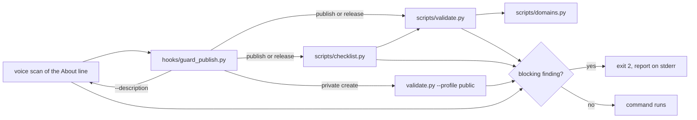

# repo-release

A Claude Code plugin that takes a repository from working to publicly readable,
and keeps it readable afterwards.

The repo gets classified before it gets checked, because one flat list blocks
too much on some repos and says too little on others. The repo type decides the
list. The repo with a `Cargo.toml` needs a licence field or crates.io rejects
the publish. The repo with a `package.json` needs `files` or it ships its tests.
The repo with `.claude-plugin/` needs valid `plugin.json` or it does not
install.

Five skills explain why each check exists. The skills leave the checking to a
validator, which decides whether the files hold. The skills also name steps,
and a checklist gate decides whether every one was done. A hook refuses the
publish until both pass, and only the user can grant an exception.

## Commands

```
/repo-release:publish    publish surface, domain audit, verification
/repo-release:hygiene    ignore rules, tracked output, CI gates
/repo-release:version    version, changelog and tag agreeing
/repo-release:agent      AGENTS.md, bridges, project rules
/repo-release:gate       the full publish checklist, item by item
```

Each command routes to one skill and runs the validator first, so the audit
faces the same checks the hook applies.

## Skills

| Skill | Use it when |
|---|---|
| `publish-repo` | taking a repo public, or shipping a first release |
| `repo-hygiene` | ignore rules, tracked build output, CI gates |
| `repo-versioning` | choosing a version, writing the changelog, cutting the tag |
| `agent-native-repo` | writing AGENTS.md, tool bridges and project rules |
| `domain-gates` | a gate blocks on a rule that does not fit, or adding a repo type |

## Install

```bash
claude plugin marketplace add Synx-x/repo-release
claude plugin install repo-release@repo-release
```

## Why a validator

A checklist in a skill is advice. Advice is skipped at the moment it matters
most, which is late in a session when the push is one command away.

The validator turns the checklist into an exit code:

```bash
python3 scripts/validate.py /path/to/repo --profile public --domain auto
```

It exits 1 on a blocking finding, and the hook refuses the publish command. Two
profiles:

| Profile | Checks |
|---|---|
| `public` | README, LICENSE, ignored-but-tracked files, machine-local paths, credential shapes, cited paths, `.env.example`, bridges, ignore rules, README images, conformance, README voice and structure. Runs on every `gh repo create`, private included |
| `release` | all of `public`, plus manifest version, changelog entry and tag agreeing |

### Required conventions

Repo conventions hold on every repo, private or public, because a warning is
easy to skip. Every warning therefore blocks, unless `KEEP_WARN` in
`scripts/validate.py` names a reason it cannot:

| Stays a warning | Reason |
|---|---|
| `check-error` | the tool crashed, and no repo change fixes it |
| `domain-unknown` | the detector could not classify the repo |
| `python-not-typed-marker`, `npm-no-exports` | right for a library, wrong for an app or CLI |
| `mcp-registry-missing`, `mcp-server-json-field` | registry listing is optional, and wrong when private |
| `readme-diagram-missing`, `readme-tree-missing` | warn only for a single-folder repo |

Four rules guess, so they block only at release: `skill-long`, `bridge-long`,
`cli-no-usage` and `cli-no-entrypoint`. A pending version bump keeps
`dirty-tree` and `tag-missing` as warnings, because the bump commit and the tag
come after the edit. A blocking finding that started as a warning ends in
`(required)`.

### README voice and structure

A README describes the project to every reader, so it never reports the
author's machine. A README line blocks when it names a GPU, CPU or Apple chip
model, says `tested on` or `measured on`, or refers to `my laptop` or `this
machine`. A README line stating a requirement, such as "requires an RTX 2060 or
newer", passes, because a requirement is the README's job. A README line in
first person singular blocks too. README code blocks are not prose, and the
scan skips them. The About line gets the same scan.

A README for a repo with two or more content directories also needs an
architecture diagram, as a `mermaid` block or an image named for the
architecture, and a fenced tree map of the layout. A README for a
single-directory repo gets a warning instead.

### Conformance, measured rather than assumed

Five conventions come from counting 20 top-starred repos on 2026-10-24. Each
finding carries its own ratio, so a reader can argue with the number.

| Convention | Measured | `public` | `release` |
|---|---|---|---|
| a security reporting route | 10 of 20 | warn | block |
| a CI workflow | 18 of 20 | warn | block |
| `CONTRIBUTING.md` | 16 of 20 | warn | block |
| `.gitattributes` | 15 of 20 | warn | block |
| a dependency-update config | 15 of 20 | note | note |

`CODE_OF_CONDUCT.md` was measured at 6 of 20 and left out. A convention that
half the best repos skip is a gap, not a defect, and a gate that fires on it
teaches people to ignore the gate.

## The checklist gate

The validator checks files. It never checked whether the steps were done. An
agent could skip reading config files for secrets, skip the CI run, or tag
before the changelog commit, and the gate let the publish through.

`scripts/checklist.py` holds every line of every skill's `## Checklist` as a
gate item. A test fails when a skill gains a line the gate does not map, so the
two cannot drift apart.

```bash
python3 scripts/checklist.py /path/to/repo --profile release
```

| Kind | Decided by | Examples |
|---|---|---|
| `auto` | the tree, git or the validator, every run | annotated tag at HEAD, version and changelog in one commit, `## [Unreleased]` open |
| `remote` | GitHub through `gh`, or the network | description and topics read back, CI green on HEAD, README images return 200 |
| `attest` | a reader, recorded against the HEAD commit | config files read by eye for secrets, open gaps written down |

An attest item passes only with written evidence recorded against the current
commit:

```bash
python3 scripts/checklist.py . attest gaps-written --evidence "README Limits lists the two open gaps"
```

The record lives in `.git/repo-release/`, so it is never published. A new
commit voids every attestation, so a judgement about an older tree never covers
a newer one.

Nothing is skipped silently. A missing file never excuses an item: the
`scaffold-complete` item requires every template file, with every placeholder
filled, so a repo without `AGENTS.md` fails rather than skips the agent-native
items. Run `scripts/scaffold.py` to add the missing files, then fill them.

An item that genuinely does not apply, such as the domain-gate items on a repo
that builds no domain gates, still blocks until a reader confirms it. One
record covers a whole skill or a single item:

```bash
python3 scripts/checklist.py . attest na:domain-gates --evidence "a CLI with no domain detector"
```

The `domain-review` item asks the model to review what the detected domain
needs at runtime, add it, and record the review. The record must name the
detected domain, so a review of the wrong repo type does not pass.

## Domain gates

A repo's needs follow its type. `--domain auto` detects the type, then applies
what that type needs. Run `--list-domains` for the full set.

| Domain | Detected by | Adds |
|---|---|---|
| `claude-plugin` | `.claude-plugin/` | `plugin.json`, `marketplace.json`, `SKILL.md` frontmatter and `hooks.json` all valid, blocking because an invalid manifest breaks install |
| `mcp-server` | `server.json`, an MCP dependency, or `initialize` + `tools/call` | a transport named in the README, a registry file |
| `monorepo` | `pnpm-workspace.yaml`, `turbo.json`, `workspaces` | a CI workflow, `CODEOWNERS` |
| `rust-crate` | `Cargo.toml` | a licence field (blocking, since crates.io rejects without it), `Cargo.lock`, `SECURITY.md` |
| `node-library` | `package.json` | `files`, `exports`, `engines` |
| `python-library` | `pyproject.toml`, `setup.py` | `requires-python`, tests, `py.typed` when annotated |
| `docs` | over 70% markup | a README entry point |
| `generic` | anything else | the base checks only |

Every rule cites the maintained repo that its evidence comes from. `sindresorhus/got` is
why `files` and `exports` are checked. `wshobson/agents` is why plugin JSON
validity is a CI gate. `sharkdp/bat` and `clap-rs/clap` are why the licence
field blocks a Rust crate. See `skills/domain-gates/SKILL.md` for the evidence.

## What it catches

Each of these has shipped in a real repo before the check existed.

- **A tracked dependency tree.** `.venv/` committed before the ignore rule.
  Once public, the vendored tree outnumbers anything written by hand.
- **A credential shape.** AWS, GitHub, Anthropic, OpenAI, Slack, Google keys,
  and private key blocks. Narrow on purpose, because a broad pattern turns
  every documented placeholder into a blocker and the gate gets switched off.
- **A machine-local path.** A contributor's home directory named inside a
  contribution guide resolves to nothing on a reader's machine, and they never
  find out.
- **A bridge that diverged.** A tool file that restates conventions instead of
  importing the canonical guide drifts within a week.
- **A version with no changelog.** A tag nobody can read is a number, not a
  release.

## Templates

`scripts/scaffold.py` copies the full set into a repo and never overwrites an
existing file, because the usual case is adding the missing pieces to a repo
with a README worth keeping.

```bash
python3 scripts/scaffold.py . --name mytool --owner Synx-x --license MIT
```

It writes `README.md`, `AGENTS.md`, thin `CLAUDE.md` and `GEMINI.md` bridges,
`CHANGELOG.md`, `CONTRIBUTING.md`, `SECURITY.md`, `.env.example`,
`.gitignore`, `.github/workflows/ci.yml`, and an example rule and workflow under
`.agents/`.

## Status

Working and tested: the validator, the checklist gate, the scaffold, the hook
and the domain gates. The full suite passes. Each check is tested against a
fixture repo holding exactly the defect under test, so a passing suite means the
checks discriminate rather than that the fixtures are empty.

Open gaps:

- An `attest` item trusts the evidence it is given. The gate makes a skipped
  judgement visible and costly, but it cannot prove the reading happened.
- The tamper guard matches commands by pattern. A write it does not recognise,
  such as a script that edits the installed plugin indirectly, gets through.
- The hook fails open on its own crash, so a hook bug allows the publish.
- `remote` items need `gh` and the network. Offline, they fail and block.

The check set survives a repo it was not written around. A fixture cannot prove
that, and two defects here shipped for three releases because only this tree was
ever tested. The check set now runs on a second, unrelated repo before each
release, and both defects surfaced the first time it did.

The hook has run on real publishes. `webbridge` and this repo both went public
through it, and the version guard fired on the edits that cut their tags.

## Configuration

| Variable | Default | What it does |
|---|---|---|
| `REPO_RELEASE_MODE` | `strict` | `off`, `warn` or `strict`. `strict` blocks the publish while a blocking finding stands. |
| `REPO_RELEASE_STATE` | `~/.claude/state/repo-release` | Where user approvals are stored. Tests point it at a temporary directory. |

Strict is the default because the validator exits 0 on a clean tree. A guard
that only warns on a discriminating check is a guard nobody reads.

The hook fails open. A crash inside it allows the call, because a broken gate
must never strand the action it guards. A crashed check inside the checklist is
different: it counts as a fail, so a broken check still blocks.

Only the user can grant an exception. Type `[publish-ok]` in a prompt and the
next publish or version edit in that session skips the gate once. The approval
comes from the user's prompt, which the agent cannot write, so `[publish-ok]`
inside a tool call does nothing.

The hook also refuses a tool call that would switch it off: an edit to the
installed plugin, a write to the approval store, a settings change that sets
`REPO_RELEASE_MODE` or disables the plugin. `off` mode does not lift this guard.

## How it works



```text
repo-release/
├── .claude-plugin/     plugin and marketplace manifests
├── commands/           five slash commands, one per skill
├── hooks/              guard_publish.py and its hooks.json registration
├── scripts/
│   ├── validate.py     file checks, two profiles
│   ├── checklist.py    every skill checklist line as a gate item
│   ├── domains.py      repo-type detection and per-domain checks
│   └── scaffold.py     copies the template set, never overwriting
├── skills/             five skills explaining why each check exists
├── templates/          repo files and license texts the scaffold writes
└── tests/              fixture-repo tests for every check
```

`hooks/guard_publish.py` reads the Bash command or the edited file, decides
whether it publishes or changes a version, then runs `scripts/validate.py` and
`scripts/checklist.py` and exits 2 with both reports on stderr.

Any `gh repo create`, private included, runs the `public` validator. A private
create skips the checklist, because the checklist reads a live public page. Any
`--description` value gets the README voice scan.

The full gate triggers on `gh repo create --public`, `gh repo edit --visibility
public`, `gh release create`, `gh release edit --draft=false`, a `gh api` call
that creates a release, any tag push (`--tags`, `--follow-tags`, `refs/tags/`,
or a version-shaped ref), and `npm`, `pnpm`, `yarn`, `twine`, `uv`, `poetry`,
`flit` and `cargo` publishes. It follows `cd DIR &&` and `git -C DIR` to the
directory the command acts on. A version edit in `pyproject.toml`,
`package.json`, `Cargo.toml` or `plugin.json` runs the validator only, because
the tag and the CI run come after the bump.

The skills explain why each check exists. The validator only says whether it
holds. Keeping the judgment out of the code is what makes the answer the same
on every run.

## Contributing

See [CONTRIBUTING.md](CONTRIBUTING.md).

## License

MIT. See [LICENSE](LICENSE).
